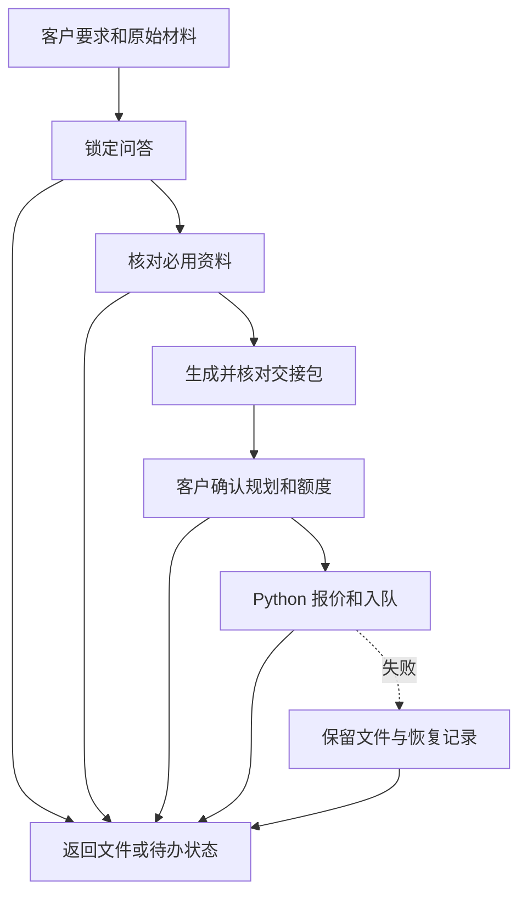

# 规划节点与流转

逐节点使用 `spawn_agent(fork_turns="none")`，仅传原始任务输入、前驱输出、允许资源和独立目录。代理不能代客户答问或批准。需要客户答复时返回待办状态，由主代理呈现，收到新答复后从持久记录恢复。用 `python -X utf8 scripts/router.py workflow.json 节点结果.json --steps N` 选择下一节点。所有节点错误都进 failure，实际没有独立代理时报告并保存进度。

- questions 按下文检查关键答复。未锁定时输出当前待问项、推荐答案与 `ready: false`，齐备后输出锁定任务单与 `ready: true`。
- sources 必用论文缺全文先检索下载，未获全文时写清缺项和下载尝试。输出材料清单与 `ready`。
- plan 使用任务单与清单生成、渲染和校验交接包，传递实际文件与摘要。
- approval 读取客户真实答复，输出 `confirmed`。待答复或要求修改时返回客户需处理项；修改后从问答与材料变动点重新检查。
- submit 在确认后执行 Python 收发脚本。已入队时按收发协议启动原订单的等待面板，由主代理打开右侧面板。保留原单状态与错误回执。
- failure/output 汇总工件与实际状态。待答复、缺全文、现网未开放和提交失败分别记录。

## 逐项问答

第一次提问前先提醒客户一次：「和主题相关的图片越充足越好，有原图、数据图或参考图可以一起发。」然后继续当前的一项问题。

1. 从对话、现有任务单和适用偏好恢复进度。按受众、时长、汇报重点、预期收获、内容边界和资料范围检查缺项，只选当前最影响规划的一项。已明确的答案直接沿用。页数、章节等可由已有约束推出的排页决定记为方案选择，放在方案中供审阅。
2. 主代理每轮只呈现一个问题和一个具体推荐。用户可以自己选，也可以直接用推荐。推荐随当前问题给出，收到答复后将结果写入任务单，再呈现下一项。用户一次主动补全多个事项时一并记录。
3. 用户自行作答或采用当前推荐，都将选定的答案记为 `confirmed`，保留答复出处。用户明确委托时记为 `delegated`，同时记录委托范围和实际选择。既有偏好注明出处。用户部分答复时，仅锁定已明确的部分。
4. 关键项齐备后直接进入资料核对。继续任务时从最近的待问项恢复。

