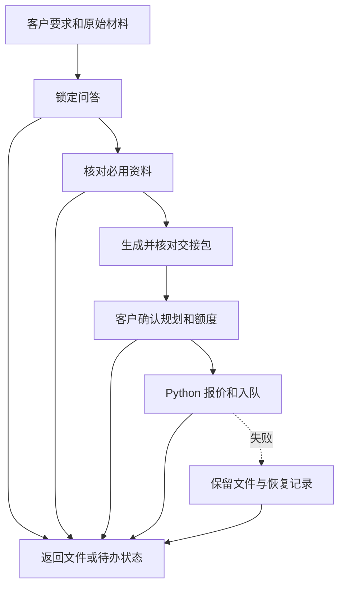

# 规划节点与流转

逐节点使用 `spawn_agent(fork_turns="none")`，仅传原始任务输入、前驱输出、允许资源和独立目录。代理不能代客户答问或批准。需要客户答复时返回待办状态，由主代理呈现，收到新答复后从持久记录恢复。用 `python -X utf8 scripts/router.py workflow.json 节点结果.json --steps N` 选择下一节点。所有节点错误都进 failure，实际没有独立代理时报告并保存进度。

- questions 按下文检查关键答复。未锁定时输出当前待问项、推荐答案与 `ready: false`，齐备后输出锁定任务单与 `ready: true`。
- sources 必用论文缺全文先检索下载，未获全文时写清缺项和下载尝试。输出材料清单与 `ready`。
- plan 使用任务单与清单生成、渲染和校验交接包，传递实际文件与摘要。
- approval 读取客户真实答复，输出 `confirmed`。待答复或要求修改时返回客户需处理项；修改后从问答与材料变动点重新检查。
- submit 在确认后执行 Python 收发脚本。已入队时按收发协议启动原订单的等待面板，由主代理打开右侧面板。面板可访问后立即进入 output 结束本轮聊天，只留进度入口；不在聊天或代理中轮询、等待、定时播报。保留原单状态与错误回执。
- output 对已入队且面板已打开的订单，只回复「已上传，[查看进度](实际 progress_url)」，立即结束本轮；成品回传和预览交给后台。failure/output 对其他情况汇总工件与实际状态。待答复、缺全文、现网未开放和提交失败分别记录。

## 逐项问答

第一次提问前先提醒客户一次：「和主题相关的图片越充足越好，有原图、数据图或参考图可以一起发。」然后继续当前的一项问题。

1. 每个新制作任务必须实际询问六项：`audience` 受众、`duration` 讲解时长与是否包含问答、`focus` 汇报重点、`outcome` 希望听众获得什么、`scope` 内容边界、`materials` 资料范围。六项都不能因代理觉得信息充分、可推断或有历史偏好而跳过。已有信息作为推荐答案，以确认式问题询问用户。
2. 主代理必须使用可用的用户提问工具呈现当前一项；没有提问工具时在回复中直接提问并等待。每轮只问一个问题并给一个具体推荐。用户未回复时保留 `ready: false`，不得自行采用推荐、填写答复或进入后续生成及提交步骤。用户主动补充其他事项时记录为后续确认项。
3. 每项记录 `field`、实际呈现的 `question`、`asked: true`、用户答复得到的 `answer`、`state` 和 `response_source`（可核对的用户回复原文或消息编号）。自行作答或明确采用当前推荐记为 `confirmed`。只有用户在该问题后明确授权代选，才能记为 `delegated`，并在答复出处中保留授权、记录实际选择；宽泛的“帮我做 PPT”不是代答授权。代理不能代用户确认。
4. 六项都有真实提问及答复记录后，才设置 `questions_locked: true` 和 `ready: true`。继续同一个任务时只恢复已完成的真实问答记录，不重复询问已完成项。任务单只有答案、没有提问及用户答复出处时，仍须提问确认。
5. 问答完成只允许进入资料核对及规划。提交前仍须另行获得当前规划文件版本与额度的明确确认。
