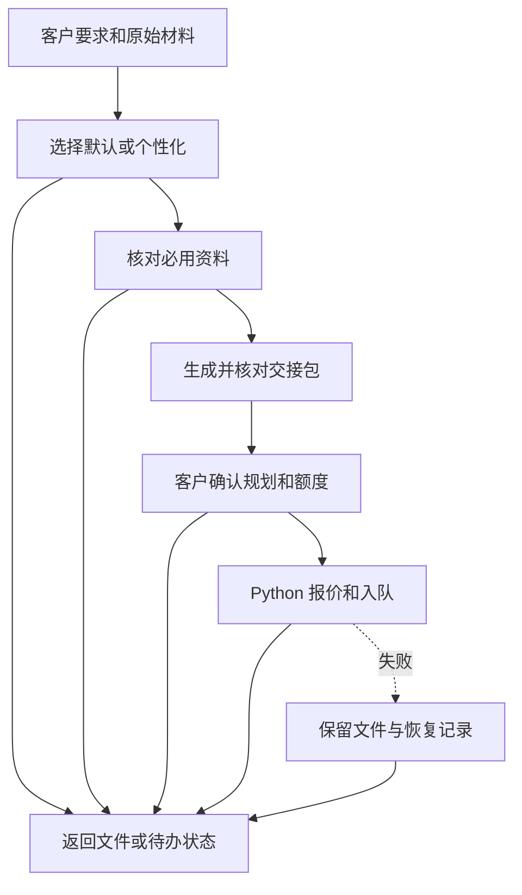

# 规划节点与流转

逐节点使用 `spawn_agent(fork_turns="none")`，仅传原始任务输入、前驱输出、允许资源和独立目录。代理不能代客户答问或批准。需要客户答复时返回待办状态，由主代理呈现，收到新答复后从持久记录恢复。用 `python -X utf8 scripts/router.py workflow.json 节点结果.json --steps N` 选择下一节点。所有节点错误都进 failure，实际没有独立代理时报告并保存进度。

- questions 按所选模式锁定要求。尚未选模式，或个性化有未答项时，输出当前待问项、推荐答案与 `ready: false`。锁定后输出任务单与 `ready: true`。
- sources 必用论文缺全文先检索下载，未获全文时写清缺项和下载尝试。输出材料清单与 `ready`。
- plan 使用任务单与清单生成、渲染和校验交接包，传递实际文件与摘要。
- approval 按[客户确认](handoff.md#客户确认)准备当前 PDF 的分区页码、大纲及逐页内容清单，由主代理先完整展示，再询问是否按此版内容制作并使用相应额度。只有收到针对该版本内容的真实肯定答复才输出 `confirmed: true`；未答复或要求修改时输出 `confirmed: false`，不得进入 submit。修改后重新核对并展示新版本。
- submit 在确认后执行 Python 收发脚本。已入队时按收发协议启动原订单的等待面板，由主代理打开右侧面板。面板可访问后立即进入 output 结束本轮聊天，只留进度入口；不在聊天或代理中轮询、等待、定时播报。保留原单状态与错误回执。
- output 对已入队且面板已打开的订单，只回复「已上传，[查看进度](实际 progress_url)」，立即结束本轮；成品回传和预览交给后台。failure/output 对其他情况汇总工件与实际状态。待答复、缺全文、现网未开放和提交失败分别记录。

## 选择模式

第一次提问前先提醒客户一次：「和主题相关的图片越充足越好，有原图、数据图或参考图可以一起发。」然后只呈现两个选项，推荐「默认」。客户开场已经明确选择模式时，记录其选择，不重复询问。继续旧任务时恢复原任务单，已提交的订单直接查原单。

- **默认（推荐）**：沿用客户已明确的要求，其余按主题、场景和资料拟定。通常使用 16:9、客户使用的语言，以及适合场景的风格和受众深度。页数和时长按内容量拟定，无明确问答要求时按纯讲解计。有明确参考模板则沿用；其余要求按本次材料和汇报目的拟定。直接进入资料核对和规划，把实际采用的参数随逐页安排一起给客户确认，不逐项提问。缺主题或必用原始资料且无法自行补齐时，仅请客户补齐该材料。
- **个性化**：按下文逐项询问。已经提供的答案以确认式问题呈现，按原任务记录恢复时不重复已确认的项。

记录 `intake.mode` 为 `default` 或 `personalized`，并在 `intake.response_source` 保留用户选择原文或消息编号。默认值是本次采用的参数，不作为用户的逐项答复记录。两种模式都须单独确认本次规划及额度才可上传。

## 个性化逐项问答

1. 选择个性化后逐项实际询问：`style` 风格、`audience` 受众、`page_count` 最终 PPT 页数、`language` 语言、`aspect_ratio` 比例（推荐 16:9）、`template` 是否选模板及模板名称/编号/文件；以及 `duration` 讲解与问答时长、`focus` 汇报重点、`outcome` 预期收获、`scope` 内容边界、`materials` 资料范围。不能因信息充分或有历史偏好跳过；已有信息改为确认式提问。无模板也是一个明确选择。
2. 主代理必须使用可用的用户提问工具呈现当前一项；没有提问工具时在回复中直接提问并等待。每轮只问一个问题并给一个具体推荐。用户未回复时保留 `ready: false`，不得自行采用推荐、填写答复或进入后续生成及提交步骤。用户主动补充其他事项时记录为后续确认项。
3. 每项记录 `field`、实际呈现的 `question`、`asked: true`、用户答复得到的 `answer`、`state` 和 `response_source`（可核对的用户回复原文或消息编号）。自行作答或明确采用当前推荐记为 `confirmed`。只有用户在该问题后明确授权代选，才能记为 `delegated`，并在答复出处中保留授权、记录实际选择；宽泛的“帮我做 PPT”不是代答授权。代理不能代用户确认。
4. 全部都有真实提问及答复记录后，才设置 `questions_locked: true` 和 `ready: true`。继续同一个任务时只恢复已完成的真实问答记录，不重复询问已完成项。任务单只有答案、没有提问及用户答复出处时，仍须提问确认。
5. 问答完成只允许进入资料核对及规划。提交前仍须另行获得当前规划文件版本与额度的明确确认。

## 逐页大纲

本次参数锁定后，在本流程内整理逐页大纲，输出文字内容与排版说明。

1. **明确讲述目标**：把用户希望听众理解的结论、支撑材料及不展开的范围整理为任务单。按确认的受众和讲解时间决定术语深度、论证顺序及每页的信息量。
2. **安排全篇结构**：先在总页数内预留首页（封面）、目录页和最后的感谢页，再分配背景、问题、证据、分析、结论等正文页。默认顺序为“首页 → 总目录 → 正文（按章节穿插目录/导航页）→ 感谢页”，三类结构页都必须作为独立页面写入大纲，不能遗漏，也不能仅在制作注释里提及。首页写主题及已知的汇报人、单位、日期，不编造缺失身份信息；开头的总目录展示全篇章节，正文中可按内容结构插入章节目录页，或重复总目录并高亮当前章节作为导航；不要求每章机械插入，也不限制整套只有一张目录。所有目录页须对应实际章节、顺序及当前进度，在大纲中独立列页；末页使用“感谢聆听”等适合场景的结束语。每页只设一个清晰目的，标题表达实际内容。三类结构页全部计入确认的 PPT 总页数和报价：例如总共 10 页，不需章节导航时可分配为 1 页首页、1 页总目录、7 页正文、1 页感谢页；若安排 2 页章节导航，则相应改为 5 页正文，总数仍为 10 页，不能在已确认 10 页之外另加 3 页。用户明确要求省略、合并或只制作局部页面时遵从并记录；固定页数不足以容纳这些页面及必要正文时，先确认如何取舍，不擅自加页。
3. **写出可制作的正文**：逐页填写真正要上屏的完整文字 `content`，不只写“介绍背景”“放图”等占位说明。用 `story` 说明本页要证明什么，`evidence` 标明引用依据和资料位置，`visual` 指向用户提供的图表、原图或后续制作需要的图形。缺少数据时注明待补，不编造指标。
4. **写清页面排版**：按内容关系选择对照、流程、时间轴、分栏、图文组合或数据展示等布局；在 `layout` 中说明标题区、正文区、图片区的位置、占比、阅读顺序、层级与强调色。全篇统一配色和文字层级，页面可以因内容调整布局。优先保证可读性，不为复杂而复杂，不机械要求每页使用不同框架。
5. **落实模板选择**：用户可以不用模板、选模板编号或提供模板文件。记录名称、编号、应保留的样式和可调整部分；模板存在时，逐页布局以其实际结构为约束。将选择说明与实际代表页预览放入 PDF 模板区；只有编号时写清编号，不虚构预览。
6. **补齐故事与资料定位**：每页填写 `story_guide`，说明问题、关键观察、结论和转场，方便后续写故事；填写 `source_locator`，将材料定位到参考编号、原PDF物理页、图号/panel及正文关键词，或自有文件/图编号。规划稿用醒目中文明确标注首页、总目录、章节导航、正文、感谢页。文献全文已在资料区时无需在规划页重复附文献或图；自有图片按相关性尽量完整附在对应页后或集中资料区，带图注和逐页映射。具体字段见交接协议。
7. **补齐制作注释**：每页 `notes` 写清图表来源、必须保留的细节、讲解重点、转场及不应直接上屏的制作提醒。排版要求与正式正文分开，避免把注释做成幻灯片内容。
8. **核对并输出**：先按[内容与模板完整性](handoff.md#内容与模板完整性)核对全部已确认内容和参考模板：必要时等比例缩小模板整体，保留完整画面与可读性；将要求写入 PDF 模板说明和逐页排版注释，渲染检查所有页及续页，修复裁切、遮挡和溢出。再逐项检查首页、目录页、感谢页是否存在、位置是否正确，总目录和正文中的各目录/导航页是否与实际章节一致、高亮位置是否正确、是否逐页计入总数；有用户明确要求的例外则核对其记录。再核对总页数、逐页讲解时长之和、材料对应关系、术语和数字一致性，生成 `outline.json`。再生成逐页安排摘要 PPTX 和交接 PDF。PDF 严格依“问答 → 模板 → 资料 → PPT内容”排列，开头标含三类结构页的总页数及模板，每页以 `# 第 N 页：标题` 开始，正文、排版和注释齐全后交用户确认。PPT 末尾的感谢页与输出完成后聊天中的感谢语分别保留，不能互相替代。

用户确认当前文件版本和额度后，才进入原有上传制作流程。大纲整理本身不调用生图接口。
